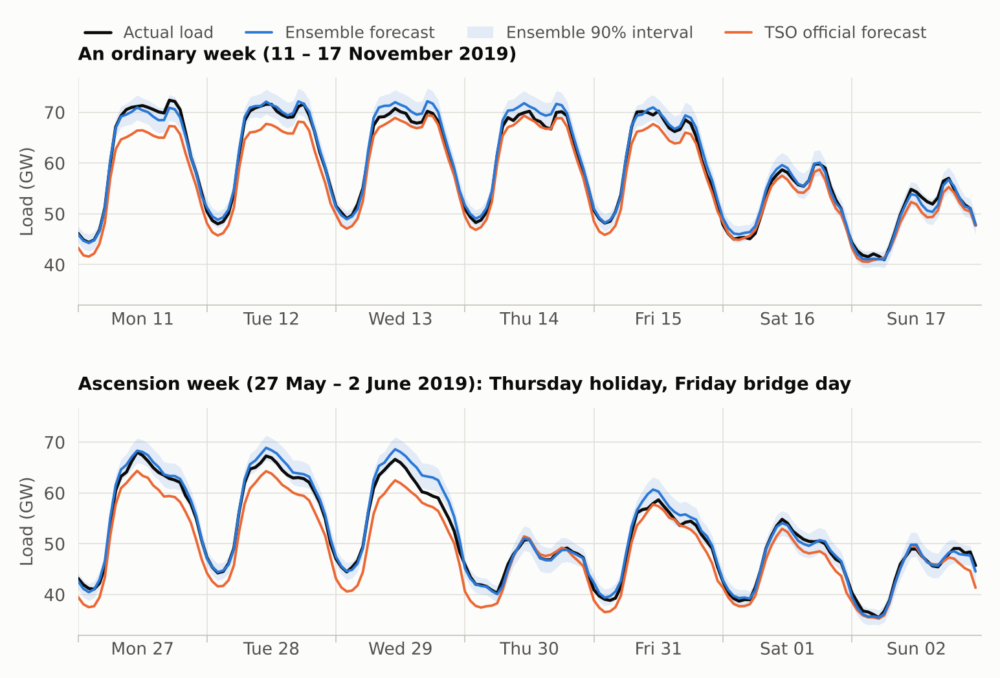
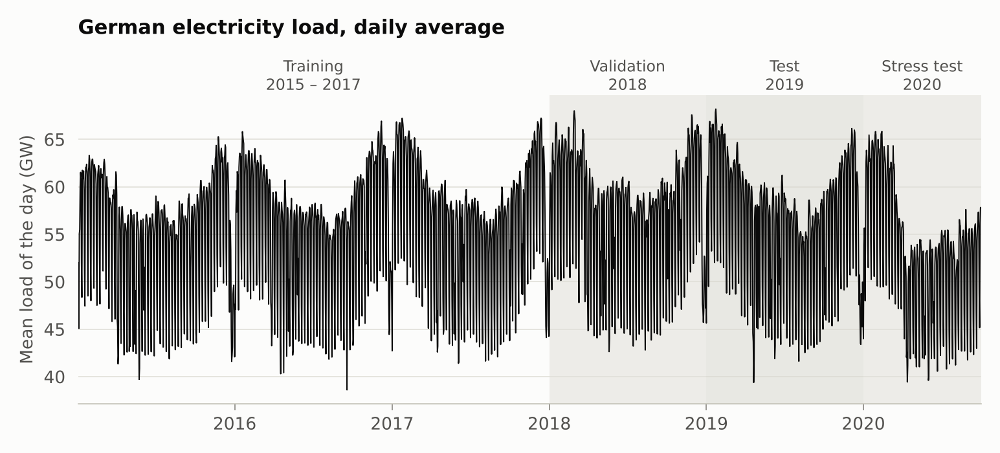
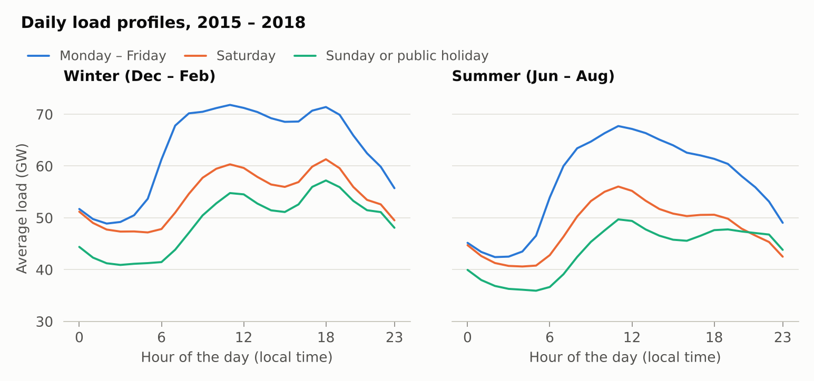
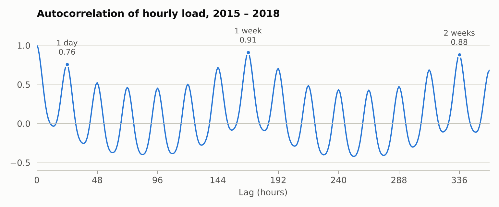
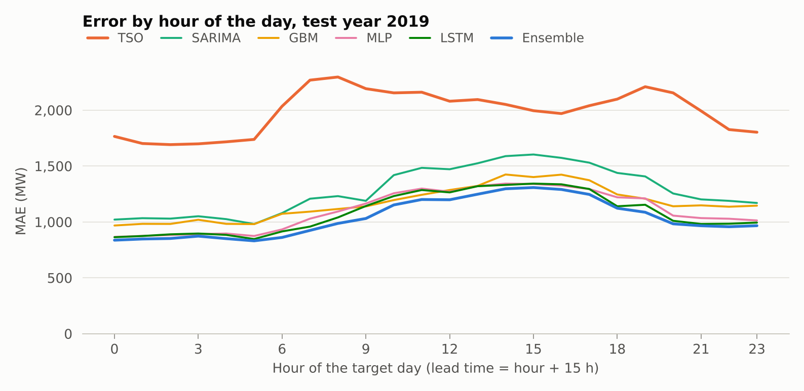
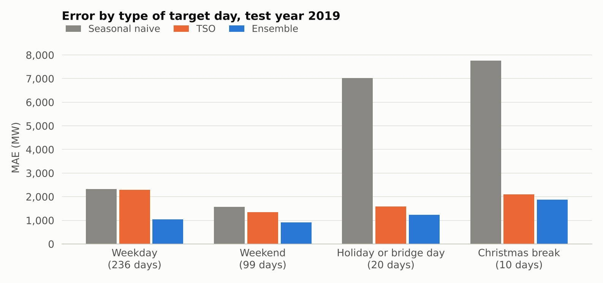
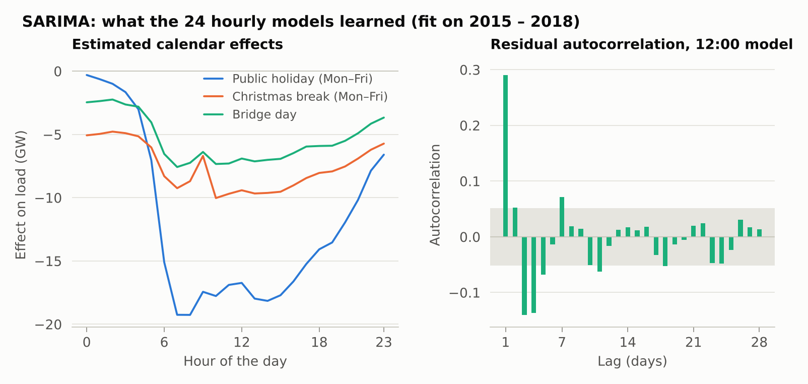
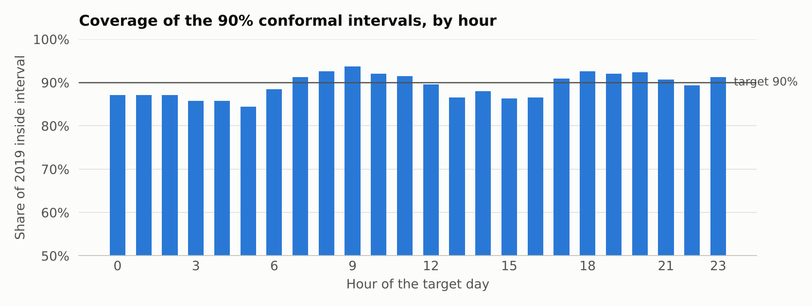
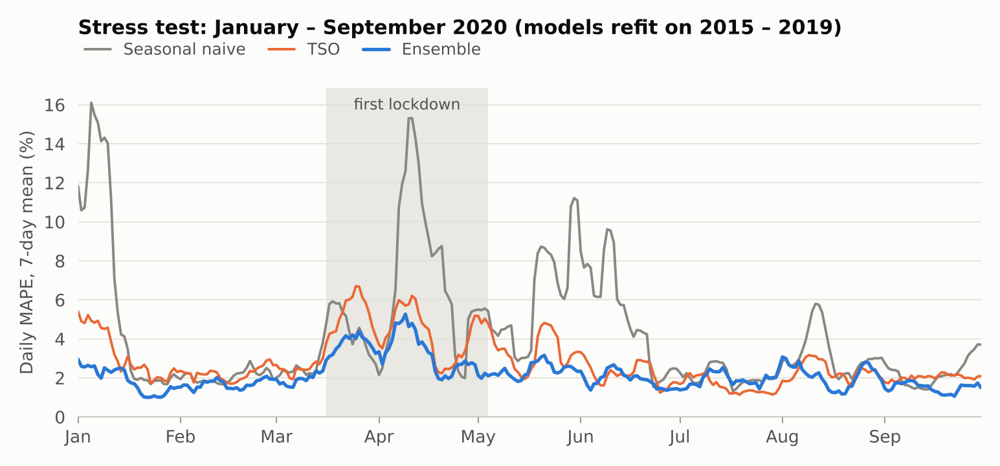

# Forecasting tomorrow's electricity demand in Germany

Every morning at 10:00, forecast Germany's electricity consumption for each of the 24 hours of the next
day. Then check the forecast against the official one published by the German grid operators.

This is a small, end-to-end time series project: raw data, a tuned ladder of models
(seasonal naive → SARIMA → gradient boosting → MLP → LSTM → ensemble), a
leakage-proof evaluation protocol, significance tests and calibrated prediction intervals.

<p align="center"></p>

**Result.** On the 2019 test year, an equal-weight ensemble of four models (SARIMA, gradient boosting,
an MLP and an LSTM) uses nothing but past load and the calendar. It forecasts the next day's hourly load
with a mean absolute error of **1,038 MW (1.89%)**. That is **48% lower than the grid
operators' official forecast** and 59% lower than repeating last week. The gap to the official
forecast is highly significant (Diebold–Mariano p < 10⁻⁶) and survives removing the operators'
systematic bias with hindsight. The ensemble's 90% prediction intervals contain the actual load in
89.3% of the hours of 2019.

| Test year 2019 | MAE (MW) | MAPE | Bias (MW) |
|---|---:|---:|---:|
| Seasonal naive: same day last week | 2,528 | 4.68% | +52 |
| Official TSO day-ahead forecast | 1,989 | 3.52% | −1,334 |
| SARIMA (classical statistics) | 1,279 | 2.35% | +42 |
| **Ensemble (this project)** | **1,038** | **1.89%** | +163 |

---

## 1. The problem

Electricity has to be produced at the very moment it is consumed, so the grid must know in
advance how much will be used. Most of Germany's power is traded on the day before
delivery, in the day-ahead auction that closes at **12:00 on day D−1** for all 24 hours of day D.
Grid operators, utilities and traders therefore all need a forecast of tomorrow's load,
hour by hour.

**The task.** Every day at **10:00** (German local time), using only

* the hourly load observed up to 10:00 today, and
* the calendar (weekday, public holidays, Christmas), which is known in advance,

forecast the average load of each hour of tomorrow, $\hat Y_{D,0},\dots,\hat Y_{D,23}$, in MW.

**Why 10:00?** It is the legal deadline for the four German transmission system operators
(TSOs) to publish their own day-ahead load forecast on the ENTSO-E Transparency Platform,
two hours before the auction closes. Using the same deadline makes their forecast a fair
benchmark: both are available at 10:00 on D−1, 15 to 38 hours before the hours they predict.

**Deliberately left out: weather.** Temperature and sunshine move German load by a few
percent, and the TSOs use weather forecasts. This project does not, so any advantage over the
official forecast has to come from better use of past load and the calendar. Leaving weather
out keeps the project small and the data to a single file.

**Metrics.** The headline metric is the mean absolute error (MAE, in MW).
## 2. Data

* **Source:** [Open Power System Data](https://data.open-power-system-data.org/time_series/2020-10-06),
  *Time series* package, version 2020-10-06, hourly file. Two columns are used:
  `DE_load_actual_entsoe_transparency`, the target (total German load), and
  `DE_load_forecast_entsoe_transparency`, the TSOs' official day-ahead forecast.
  Both come from the [ENTSO-E Transparency Platform](https://transparency.entsoe.eu/).
* **Coverage:** hourly, 2 January 2015 to 30 September 2020. The actual load has no gaps.
  The TSO forecast is missing for one day (24 September 2018).
* **Preprocessing:** UTC timestamps are converted to local time. The 23-hour and 25-hour days at the
  daylight-saving switches are regularised to 24 hours: the missing hour is interpolated and the
  doubled hour averaged. The result is a matrix of 2,099 days × 24 hours
  ([`data.py`](src/loadforecast/data.py)).

<p align="center"></p>

### What the data says

<p align="center"></p>

* **A strong daily and weekly rhythm.** On working days load climbs from 42–50 GW at night
  to 67–72 GW around noon. On average Saturdays are 16% below weekdays, and Sundays and public
  holidays 22% below.
* **Seasons.** Load is higher in winter, and winter evenings have a second peak (lighting).
  The level also drifts: 57.0 GW on average in 2018, 56.0 GW in 2019.
* **Holidays look like Sundays.** National holidays, regional holidays (weighted here by
  the population of the states that observe them), *bridge days* between a holiday and a
  weekend, and the Christmas break all depress demand. The Christmas break cuts it by 15–30%.

<p align="center"></p>

* **Last week beats yesterday.** The autocorrelation peaks at 24 hours (0.76) and even
  higher at 168 hours (0.91). A Monday resembles last Monday more than it resembles yesterday's
  Sunday. "Same hour, one week ago" is therefore the natural baseline, the *seasonal naive* forecast.

## 3. Method

### Evaluation protocol

| Split | Target days | Used for |
|---|---|---|
| Train | 16 Jan 2015 – 31 Dec 2017 (1,081 days) | fitting |
| Validation | 2018 (365 days) | choosing hyper-parameters, calibrating intervals |
| Test | 2019 (365 days) | **final evaluation**, run once after refitting on 2015–2018 |
| Stress test | Jan – Sep 2020 (274 days) | behaviour under the COVID-19 lockdown, after refitting on 2015–2019 |

The splits are strictly chronological, with no shuffling. Every input is computed from data
observed before 10:00 on D−1. A unit test checks this by overwriting all later values with
noise and verifying that the features do not change.

### Inputs

| Feature group | Used by | Details |
|---|---|---|
| Daily series of the same hour | SARIMA | each hour of the day is its own daily series; at 10:00 the morning hours of D−1 are known, the afternoon hours are not |
| Last 168 hourly loads | MLP, LSTM | the week up to 10:00 on D−1, as a flat vector (MLP) or as a sequence (LSTM) |
| Calendar of day D | all models | population-weighted holiday share, bridge-day share, Christmas break (24 Dec – 2 Jan); the ML models also get the weekday and the position in the year (two Fourier harmonics, or the raw day of the year for the GBM), while SARIMA covers the weekday with its weekly seasonality |
| Calendar of the lag days | GBM, MLP, LSTM | holiday, bridge and Christmas flags of D−1, D−2 and D−7 (also D−14 for the GBM), so a model knows when "last week" is a bad guide (SARIMA needs no such flags, see below) |
| Engineered lags | GBM | same hour 1–7 and 14 days earlier, mean of this morning, week-on-week ratio, level-corrected naive forecast, … (31 features in total) |

### Models

| Model | What it is | Chosen on 2018 |
|---|---|---|
| **Seasonal naive** | tomorrow = the same day last week | – |
| **TSO** | official forecast of the grid operators (uses weather) | – |
| **SARIMA** | classical seasonal ARIMA: 24 models, one per hour of the day, each a regression on holiday dummies with SARIMA errors on that hour's daily series (weekly season, s = 7), fitted by maximum likelihood with a Kalman filter | airline model (0,1,1)(0,1,1)₇ for the hours forecast 1 day ahead, (1,0,1)(0,1,1)₇ for those forecast 2 days ahead |
| **GBM** | histogram gradient-boosted trees, one model for all 24 hours | 2,696 trees of ≤ 15 leaves, learning rate 0.1 |
| **MLP** | feed-forward network on the last 168 hours plus the calendar; AdamW, dropout, early stopping; 5 seeds averaged | 1 hidden layer of 256 units, 56 epochs |
| **LSTM** | recurrent network that reads the last 168 hours as a sequence, plus a dense head for the calendar; 5 seeds averaged | 32 hidden units, 62 epochs |
| **Ensemble** | plain average of SARIMA, GBM, MLP and LSTM | – |

The grids were small on purpose: 5 SARIMA specifications, 4 tree configurations, 6 MLP and 2 LSTM
architectures. The complete tuning logs are in [`results/hyperparameters.json`](results/hyperparameters.json).

**Prediction intervals.** Every model also gets 90% intervals by *split conformal prediction*.
The absolute errors of the 2018 forecasts give one calibration quantile per hour of the day,
and each 2019 forecast is widened by that amount. If 2018 and 2019 errors are exchangeable,
this guarantees ≥ 90% coverage for any model.

**Significance.** Differences between models are tested with the Diebold–Mariano test on daily
MAE, with a Newey–West long-run variance.

## 4. Results

### Accuracy on the test year 2019

| Model | MAE (MW) | RMSE (MW) | MAPE | MASE | Bias (MW) |
|---|---:|---:|---:|---:|---:|
| Seasonal naive | 2,528 | 4,442 | 4.68% | 1.09 | +52 |
| TSO official forecast | 1,989 | 2,489 | 3.52% | 0.86 | −1,334 |
| SARIMA | 1,279 | 1,788 | 2.35% | 0.55 | +42 |
| GBM | 1,168 | 1,505 | 2.13% | 0.51 | +59 |
| MLP | 1,105 | 1,493 | 2.02% | 0.48 | +379 |
| LSTM | 1,082 | 1,473 | 1.96% | 0.47 | +171 |
| **Ensemble** | **1,038** | **1,394** | **1.89%** | **0.45** | +163 |

*MASE: MAE divided by the in-sample MAE of the weekly naive forecast on 2015–2018 (2,310 MW).
Bias: forecast minus actual, so a positive bias means over-forecasting. Full table and the 2018 validation scores:
[`results/summary.md`](results/summary.md).*

* **Every learned model beats both benchmarks by a wide margin.** Even the classical SARIMA, which sees
  only the history of one hour at a time, cuts the error of the official forecast by
  36%.
* **Machine learning beats classical statistics, by a modest margin.** Gradient boosting, the MLP and the LSTM
  are 9%, 14% and 15% more accurate than SARIMA. They see the whole last week across all hours,
  including this morning's load, which SARIMA's one-hour-at-a-time models cannot use.
* **A weak but different model still pulls its weight.** The ensemble is 4% better than the best single
  model (the LSTM). SARIMA is the least accurate of the four, but its errors are among the least correlated with
  the others (0.63–0.74, against 0.92 between the two networks). Diversity can make up for individual accuracy.
* **About the official forecast.** It under-forecasts by 1.3 GW on average in 2019. That
  bias changes from year to year (−1.6 GW in 2016, −0.5 GW in 2017 and 2018, +0.4 GW in 2020).

<p align="center"></p>

The error grows from about 831 MW at night to 1,308 MW in mid-afternoon. Part of that is
lead time: hour 0 is forecast 15 hours ahead, hour 23 is 38 hours ahead. Yet the error falls
again in the evening. Midday hours are hard in their own right: the load is highest there and depends
most on the weather, which these models do not see. SARIMA comes closest to the other models in the early
morning, where it forecasts one day ahead from yesterday's value of the same hour (1,085 MW on average over
hours 00–09). It falls further behind in the afternoon (1,418 MW), where it must look two days back.
The official forecast is worst during the morning ramp (07:00–09:00) and the evening peak.

### Where the errors come from

<p align="center"></p>

| MAE (MW), 2019 | Days | Seasonal naive | TSO | SARIMA | GBM | MLP | LSTM | Ensemble |
|---|---:|---:|---:|---:|---:|---:|---:|---:|
| Weekday | 236 | 2,328 | 2,289 | 1,232 | 1,165 | 1,093 | 1,086 | 1,042 |
| Weekend | 99 | 1,571 | 1,343 | 1,111 | 1,078 | 995 | 965 | 906 |
| Holiday or bridge day | 20 | 7,015 | 1,592 | 1,512 | 1,440 | 1,410 | 1,304 | 1,226 |
| Christmas break | 10 | 7,762 | 2,106 | 3,581 | 1,559 | 1,862 | 1,709 | 1,869 |

*"Holiday or bridge day" means any public holiday or bridge day outside the Christmas break, national or
regional (for example Corpus Christi, observed in six states).*

* **Holidays are where the naive forecast collapses.** Its error triples, because "the same day last week"
  was an ordinary working day. The calendar features fix most of this: on holidays and bridge days the
  ensemble's error (1,226 MW) is less than a fifth of the naive one.
* **The Christmas break is the hardest period.** It occurs only three times in the training data.
  SARIMA does worst there (3,581 MW). Its Christmas effect is one fixed amount per hour, while the ten days
  of the break each behave differently. The trees and networks learn some of those interactions. The
  ensemble inherits part of SARIMA's miss: 1,869 MW, worse than the GBM or the LSTM alone.
* **On ordinary weekdays the official forecast is no better than the naive one**
  (2,289 vs 2,328 MW). That is where its bias costs the most.

### What the SARIMA models learned

<p align="center"></p>

SARIMA is the one model here whose parameters can be read directly
([`results/sarima_parameters.csv`](results/sarima_parameters.csv)).

* **Calendar effects, hour by hour.** A public holiday on a weekday removes about 19 GW at
  07:00–08:00, nearly 30% of the usual load at that hour, but only 0.3 GW at midnight. The Christmas break
  costs 5–10 GW on weekdays, and a bridge day 2–8 GW, during the day about 40% of a full holiday.
* **The residuals are not white.** The afternoon models leave a lag-1 autocorrelation of about 0.3, and some
  negative correlation at lags 3–4 (right panel).
  Adding AR or MA terms halves it but does not improve the two-day-ahead forecasts on 2018, so the simpler models stay.

### Is the improvement real? Diebold–Mariano tests

The test compares the daily MAE of two forecasts over the 365 test days. Its variance
estimate accounts for the autocorrelation of daily errors.

| Ensemble vs | Seasonal naive | TSO | SARIMA | GBM | MLP | LSTM |
|---|---:|---:|---:|---:|---:|---:|
| DM statistic | 6.00 | 8.86 | 5.55 | 4.46 | 4.10 | 2.37 |
| one-sided p-value | < 10⁻⁶ | < 10⁻⁶ | < 10⁻⁶ | 4 × 10⁻⁶ | 2 × 10⁻⁵ | 0.009 |

The ensemble is significantly more accurate than every other forecast at the 1% level. Five of the six
p-values are far below the Bonferroni threshold for six tests, 0.05/6 ≈ 0.008. The comparison with the
LSTM (p = 0.009) sits right at it, so the gain over the best single model is real but small. Among the
individual models, the two networks are significantly better than SARIMA (p ≤ 0.0002), gradient boosting only
marginally so (p = 0.04), and the MLP and the LSTM are indistinguishable (p = 0.16). Full matrix:
[`results/dm_pvalues.csv`](results/dm_pvalues.csv).

### Prediction intervals

Split conformal intervals for the ensemble, calibrated on 2018 and evaluated on 2019:

| Nominal coverage | Actual coverage | Mean width | Weekdays | Weekends | Holidays & bridge days | Christmas break |
|---:|---:|---:|---:|---:|---:|---:|
| 80% | 76.9% | 3,051 MW | 76.8% | 80.9% | 70.2% | 52.9% |
| 90% | 89.3% | 4,152 MW | 89.6% | 92.2% | 83.8% | 65.0% |
| 95% | 94.3% | 5,115 MW | 94.9% | 96.0% | 89.2% | 75.0% |

<p align="center"></p>

* **Overall coverage is close to nominal**: 76.9%, 89.3% and 94.3% for targets of 80%, 90% and 95%.
  The method assumes that 2018 errors look like 2019 errors, and that is approximately true.

### Stress test: 2020 and the COVID-19 lockdown

<p align="center"></p>

The same models, refit on 2015–2019 with the same hyper-parameters, forecast January–September 2020.
From mid-March the lockdown pushed demand 4–6% below the same weeks of 2019, and April and May
2020 averaged 9% and 11% below the same months of 2019.

| MAPE | Seasonal naive | TSO | SARIMA | GBM | MLP | LSTM | Ensemble |
|---|---:|---:|---:|---:|---:|---:|---:|
| Jan – Feb 2020 (before COVID) | 4.32% | 2.75% | 2.46% | 1.93% | 1.82% | 1.88% | **1.78%** |
| April 2020 (lockdown) | 7.15% | 4.03% | 3.29% | **3.08%** | 4.52% | 4.64% | 3.27% |
| Jan – Sep 2020 | 4.26% | 2.81% | 2.36% | 2.36% | 2.56% | 2.73% | **2.17%** |

The ensemble beats the official forecast by a wider margin in 2020 than in 2019 (2.17% vs 2.81% MAPE over
January–September), and it is the best of all models over the nine months. The ranking underneath it changes.
In April the MLP and the LSTM over-forecast by about 2 GW: their weights pull towards the historical
level of load, so they follow a sudden drop only slowly. SARIMA over-forecasts by only 0.4 GW and the GBM by
0.8 GW. SARIMA compares each day with the same weekday a week earlier (seasonal differencing), so a level
shift is absorbed within a week. The GBM's key features are *ratios* to last week's level. The most accurate
models in normal times are not the most robust ones under a structural break. The ensemble mixes both kinds and
holds up best overall.

## 5. Takeaways

1. **The calendar matters as much as the model.** Population-weighted holidays, bridge days and
   the Christmas break remove most of the naive forecast's worst errors.
2. **Classical statistics is a strong baseline.** A SARIMA model per hour already beats the official
   forecast by 36%. Machine learning is 9–15% better still: it helps, but by percent, not by multiples.
3. **Accuracy and robustness are different things.** Under the 2020 shock, the models that compare
   with last week's level, SARIMA through seasonal differencing and the GBM through ratio features,
   held up best.

## 6. Limitations and next steps

* **No weather.** Adding temperature and solar forecasts is the obvious next step. Combining the
  models with the official forecast, which does contain weather information, as one more input is another.
* **SARIMA sees one hour at a time.** Each of its 24 models only knows the history of its own hour, so the
  afternoon models ignore this morning's load. Adding the morning mean as a regressor, or a vector model
  across hours, would give SARIMA the intraday information the networks use.
  
## 7. Reproducing the results

```bash
git clone https://github.com/lucalaiolo/DSProject.git && cd DSProject
python -m venv .venv && source .venv/bin/activate
pip install torch --index-url https://download.pytorch.org/whl/cpu   # optional: small CPU-only build
pip install -r requirements.txt && pip install -e .

python scripts/01_prepare_data.py         # download ~130 MB (checksum-verified) and reshape
python scripts/02_train_and_forecast.py   # tune, refit, forecast: about 17 min on 4 CPU cores
python scripts/03_evaluate.py             # metrics, tests, intervals -> results/*.csv, results/summary.md
python scripts/04_make_figures.py         # figures -> results/figures/
pytest                                    # 14 unit tests
```

Seeds are fixed. Exact numbers can still differ slightly across platforms and library versions,
because floating-point arithmetic in PyTorch and scikit-learn is not bit-identical everywhere.
The committed results were produced with Python 3.13, PyTorch 2.14 (CPU), scikit-learn 1.9, statsmodels 0.15 and pandas 3.0.

## 8. Repository layout

```
├── README.md                     this file
├── formulation.md                the mathematics, with derivations and proofs
├── requirements.txt, pyproject.toml
├── scripts/
│   ├── 01_prepare_data.py        download and reshape the data
│   ├── 02_train_and_forecast.py  tune on 2018, refit, forecast 2019 and 2020
│   ├── 03_evaluate.py            metrics, breakdowns, Diebold–Mariano, conformal intervals
│   └── 04_make_figures.py        all figures
├── src/loadforecast/
│   ├── config.py                 protocol constants: issue time, splits, paths
│   ├── data.py                   download, daylight-saving handling, daily matrix
│   ├── calendar_features.py      holidays, bridge days, Christmas, Fourier terms
│   ├── features.py               leakage-safe feature construction
│   ├── pipeline.py               tuning and refitting logic for every model
│   ├── models/                   baselines, SARIMA (statsmodels), GBM, MLP and LSTM (PyTorch)
│   ├── metrics.py                MAE, RMSE, MAPE, MASE, Diebold–Mariano
│   ├── conformal.py              split conformal intervals
│   └── plotting.py               shared chart style
├── tests/                        leakage, daylight saving, calendar, SARIMA forecasts, metrics, conformal
└── results/                      predictions, tables and figures (all generated by the scripts)
```

## References and data attribution

* Data: Open Power System Data (2020). *Data Package Time series*, version 2020-10-06.
  [doi:10.25832/time_series/2020-10-06](https://doi.org/10.25832/time_series/2020-10-06).
  Primary source: ENTSO-E Transparency Platform. The data is downloaded by
  `scripts/01_prepare_data.py` and is not redistributed in this repository.
* Hirth, L., Mühlenpfordt, J., & Bulkeley, M. (2018). The ENTSO-E Transparency Platform – A review of
  Europe's most ambitious electricity data platform. *Applied Energy*, 225, 1054–1067.
